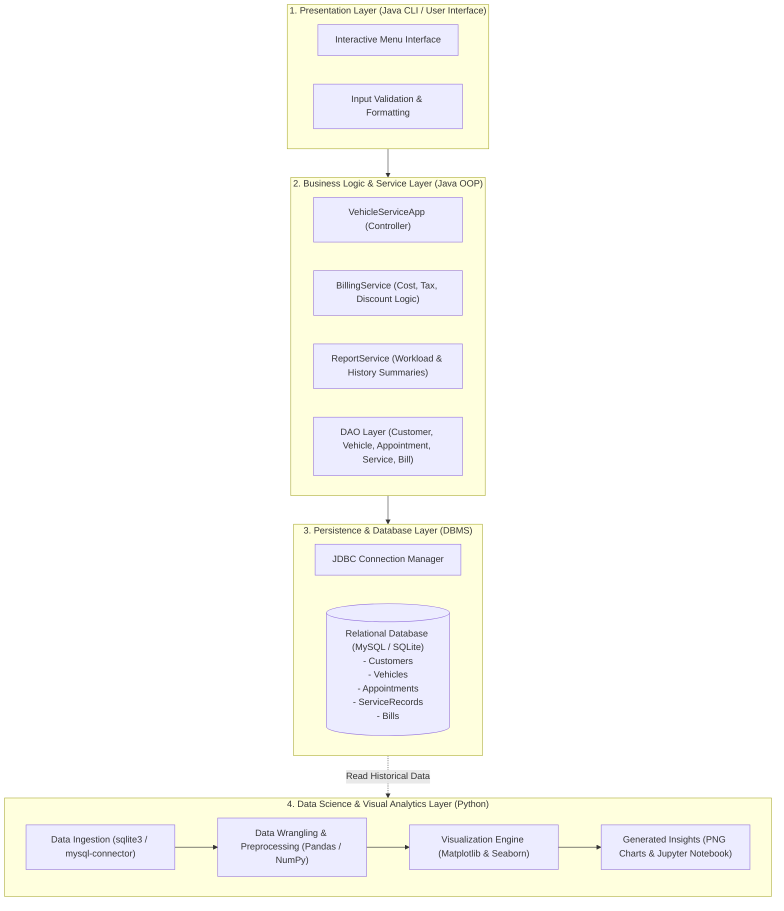
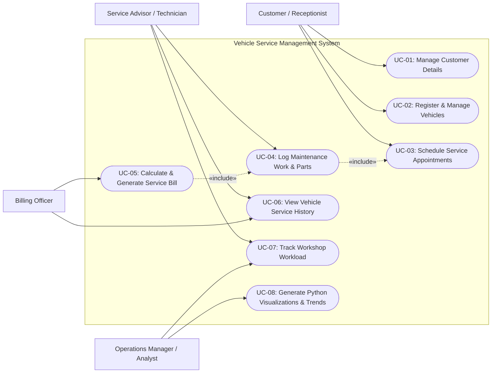
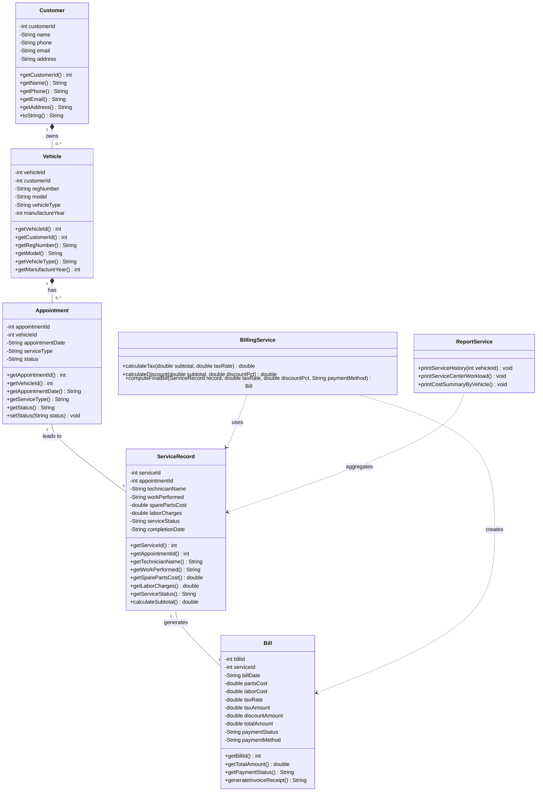
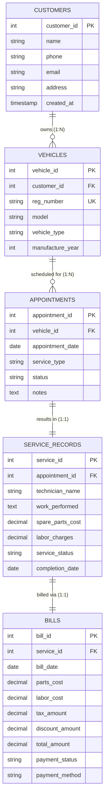

# System Architecture & Design Specification
## Vehicle Service Management and Maintenance Analysis System

---

**Institution:** Velalar College of Engineering and Technology, Erode – 12  
**Department:** Department of Information Technology  
**Course Codes:** 25ITT31 (DBMS), 25ITT32 (Java), 25ITT33 (Software Engineering), 25ITC31 (Data Science)  
**Academic Year:** 2026–2027 (ODD Semester)  
**Class:** 25IT3A & 25IT3B  
**Scenario 16 (Register Nos: 16, 46, 76, 106)**

---

## 1. System Architecture Overview

The **Vehicle Service Management and Maintenance Analysis System** is engineered using an enterprise three-tier architectural pattern. This separates user interaction, business processing logic, and persistent storage, while integrating an analytical engine for business intelligence.

---

## 2. Use Case Diagram

The Use Case Diagram defines the interactions between the system's primary actors (**Customer / Receptionist**, **Service Advisor / Technician**, **Billing Officer**, and **System Administrator / Analyst**) and the core functionalities.

---

## 3. Class Diagram

The Class Diagram highlights the Object-Oriented structure implemented in Java, conforming to the **25ITT32 (Java Programming)** course specifications. It showcases encapsulation, relationships, data access objects (DAOs), and service interfaces.

---

## 4. Entity-Relationship (ER) Diagram

The Entity-Relationship (ER) diagram models the conceptual database schema designed in accordance with **25ITT31 (Database Management Systems)**.

---

## 5. Relational Schema & Integrity Constraints

The conceptual model is mapped into the following relational model with primary key (PK), foreign key (FK), and unique key (UK) constraints:

1. **`customers`** (`customer_id` [PK], `name`, `phone`, `email`, `address`, `created_at`)
2. **`vehicles`** (`vehicle_id` [PK], `customer_id` [FK -> `customers.customer_id` ON DELETE CASCADE], `reg_number` [UK], `model`, `vehicle_type`, `manufacture_year`)
3. **`appointments`** (`appointment_id` [PK], `vehicle_id` [FK -> `vehicles.vehicle_id` ON DELETE CASCADE], `appointment_date`, `service_type`, `status`, `notes`)
4. **`service_records`** (`service_id` [PK], `appointment_id` [FK -> `appointments.appointment_id` ON DELETE CASCADE], `technician_name`, `work_performed`, `spare_parts_cost`, `labor_charges`, `service_status`, `completion_date`)
5. **`bills`** (`bill_id` [PK], `service_id` [FK -> `service_records.service_id` ON DELETE CASCADE], `bill_date`, `parts_cost`, `labor_cost`, `tax_amount`, `discount_amount`, `total_amount`, `payment_status`, `payment_method`)
